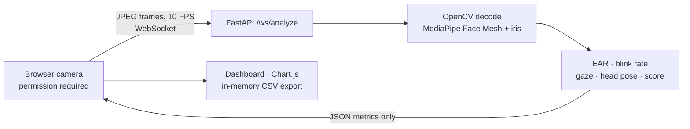

# FocusPulse AI

FocusPulse AI is a real-time attention dashboard built with FastAPI, WebSockets, OpenCV, and MediaPipe Face Mesh with iris landmarks. It estimates eye aspect ratio (EAR), blink rate, iris-based gaze direction, head pose, and a smoothed **Focus Velocity Score** from 0 to 100. A dark browser dashboard shows live metrics and a session chart; users can export per-second activity to CSV or a paginated PDF report.

> **Important limitations:** These signals are rough visual heuristics, not validated measurements of attention or drowsiness. Lighting, camera position, glasses, face shape, movement, and model error affect results. Do not use the estimates for medical diagnosis, driver or machinery safety, employment, education grading, or other consequential decisions.

## Architecture



Frames are held in memory while being processed and are **not written to disk or uploaded to a third-party service**. The app does not record audio. The browser streams frames to the server running this application; use a trusted server and an encrypted HTTPS/WSS connection in production.

## Requirements

- Python **3.10–3.12** (Python 3.11 recommended). MediaPipe 0.10.21 does not provide supported wheels for every Python version; Python 3.13/3.14 is not a supported target for this pinned release.
- A modern browser with camera access. Camera APIs generally require **HTTPS**, except on `localhost`.
- A working webcam, adequate lighting, and a front-facing view for best-effort estimates.

## Run locally

```powershell
py -3.11 -m venv .venv
.\.venv\Scripts\Activate.ps1
python -m pip install --upgrade pip
pip install -r requirements.txt
uvicorn app:app --reload --host 127.0.0.1 --port 8000 --ws-max-size 2010000
```

Open [http://localhost:8000](http://localhost:8000), allow camera access, and select **Start session**. Use `Ctrl+C` to stop the server. On Windows, if `py -3.11` is unavailable, install Python 3.11 and use its interpreter to create the environment.

## Tests

Install the development test dependencies and run the backend/API checks:

```powershell
pip install -r requirements-dev.txt
python -m pytest -q
```

## Configuration

| Environment variable | Purpose | Default |
| --- | --- | --- |
| `FOCUSPULSE_ALLOWED_ORIGINS` | Optional comma-separated exact browser origins permitted to open a WebSocket (for example `https://focuspulse.example.com`). Set this for public deployments. | Same-origin requests only |
| `LOG_LEVEL` | Python logging level. | `INFO` |

The server accepts JPEG frames up to 1.5 MB and 1280×720. The dashboard streams 640×480 images at approximately 10 FPS. The backend caps concurrent frame analyses at three sessions per process. Scale out only after load testing and account for CPU and memory per active Face Mesh session.

The score combines recent EAR stability, blink rate, eye openness, gaze, and head-pose estimates. It smooths declines faster than recovery. The three displayed labels are **Optimal Focus**, **Distracted**, and **Fatigued/Drowsy**; they are labels produced by thresholds, not a diagnosis. Gaze and head pose are camera/model-relative estimates. Browser-side chart history and report data live only in page memory and are cleared when the page is closed. Use **Reset** to stop monitoring and clear the timer, metrics, chart, and session export data. PDF and CSV reports aggregate the incoming samples for each elapsed session second, including second-by-second state, focus score, EAR, blink rate, gaze, pose, face visibility, and sample count; seconds without a face or samples are shown as such. Face landmarks are processed transiently for metrics and are not included in the WebSocket response.

## Deploy the dashboard to GitHub Pages

The `Deploy FocusPulse AI to GitHub Pages` workflow builds the dashboard from `templates/index.html` and `static/` on pushes to `main`. Enable **Settings → Pages → Build and deployment → GitHub Actions** once, then push to `main` or run the workflow manually under Actions. The published dashboard URL is:

**https://aniketsingh-netizen.github.io/focuspulse/**

GitHub Pages serves static files only. It cannot run FastAPI, process MediaPipe frames, or accept WebSocket analysis connections. To enable live monitoring, deploy the API separately as described below, then add a repository Actions variable named `API_BASE_URL` with the API's HTTPS origin (for example `https://your-service.onrender.com`, with no path). Re-run the Pages workflow after setting or changing the variable. Configure the API's `FOCUSPULSE_ALLOWED_ORIGINS` to `https://aniketsingh-netizen.github.io`. Until the API is deployed and configured, the Pages dashboard loads, but starting a camera session will show an explicit API configuration message.

## Deploy the API to Render

The included `render.yaml` provisions a Python 3.11 web service and runs Uvicorn with WebSocket support and an explicit frame-size limit.

1. Connect this repository to Render as a Blueprint.
2. Set `FOCUSPULSE_ALLOWED_ORIGINS` to `https://aniketsingh-netizen.github.io` (and any local development origin needed). Do not include a path or trailing slash.
3. Deploy and open the Render HTTPS URL; the browser will use a secure `wss://` connection.
4. Confirm the service plan supports the CPU and memory needed by MediaPipe; resize or scale only after testing actual concurrent sessions.
5. Add that service's HTTPS origin as the GitHub Actions repository variable `API_BASE_URL`, then run the Pages workflow again so the dashboard connects to the API.

The server is designed as a long-running ASGI process, not a serverless function. **Vercel's standard serverless functions do not provide the persistent WebSocket runtime this app requires.** Use Render or another platform that supports long-lived ASGI WebSockets unless you separately redesign the transport and deployment architecture.

## Privacy and security

- Camera access is requested only after the user starts a session, and the browser preview remains visible.
- No frame, face landmark, or session record is persisted by the application. CSV export is an explicit client-side download.
- Use HTTPS for non-local camera access and WSS for public traffic. Configure exact allowed origins, restrict access to the deployment as appropriate, and use current dependency security updates.
- Run behind a WebSocket-capable reverse proxy. Preserve the `Upgrade` and `Connection` headers and configure proxy idle/read timeouts for active sessions. Uvicorn's WebSocket maximum message size is set by the documented startup command and Render configuration.
- Third-party frontend assets (Tailwind CDN, Chart.js CDN, jsPDF CDN, and Google Fonts) are loaded by the dashboard. For a strict Content Security Policy or fully self-hosted deployment, vendor/build these assets and update the page's asset references and policy.

## Troubleshooting

- **Camera unavailable:** Allow camera access, close other applications using the webcam, and use `localhost` or HTTPS.
- **WebSocket does not connect:** Check that the ASGI service is reachable, the page origin exactly matches `FOCUSPULSE_ALLOWED_ORIGINS`, and the reverse proxy supports WebSockets.
- **Install fails:** Use Python 3.11 (or another supported 3.10–3.12 version) and a platform with wheels for MediaPipe and OpenCV. MediaPipe's Python and platform support changes over time; consult its release notes before changing the pinned version.
- **Metrics fluctuate or no face is found:** Improve frontal lighting, keep the face in view, and avoid treating the result as reliable when the face is obscured or the camera angle changes.
