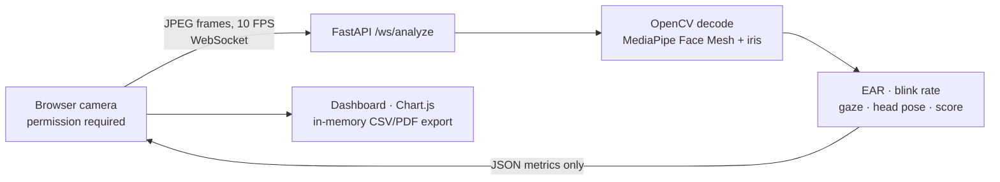

# FocusPulse AI

FocusPulse AI is a real-time attention dashboard built with FastAPI, WebSockets, OpenCV, and MediaPipe Face Mesh with iris landmarks. It estimates eye aspect ratio (EAR), blink rate, iris-based gaze direction, head pose, and a smoothed **Focus Velocity Score** from 0 to 100. The dashboard shows live metrics and a session chart; users can export per-second activity to CSV or a paginated PDF report.

> **Important limitations:** These signals are rough visual heuristics, not validated measurements of attention or drowsiness. Lighting, camera position, glasses, face shape, movement, and model error affect results. Do not use the estimates for medical diagnosis, driver or machinery safety, employment, education grading, or other consequential decisions.

## Architecture



Frames are held in memory while being processed and are **not written to disk or uploaded to a third-party service**. The app does not record audio. The browser streams frames to the configured API; use a trusted server and an encrypted HTTPS/WSS connection in production.

## Requirements

- Python **3.10–3.12** (Python 3.11 recommended). The pinned MediaPipe version does not provide supported wheels for every Python version; Python 3.13/3.14 is not a supported target.
- A modern browser with camera access. Camera APIs generally require **HTTPS**, except on `localhost`.
- A working webcam, adequate lighting, and a front-facing view for best-effort estimates.

## Run locally

```powershell
py -3.11 -m venv .venv
.\.venv\Scripts\Activate.ps1
python -m pip install --upgrade pip
pip install -r requirements.txt
uvicorn app:app --reload --host 127.0.0.1 --port 8000 --ws-max-size 2010000
```

Open [http://localhost:8000](http://localhost:8000), allow camera access, and select **Start session**. Use `Ctrl+C` to stop the server. On Windows, if `py -3.11` is unavailable, install Python 3.11 and use its interpreter to create the environment.

## Tests

Install the development test dependencies and run the backend and static-build checks:

```powershell
pip install -r requirements-dev.txt
python -m pytest -q
```

## Configuration

| Environment variable | Purpose | Default |
| --- | --- | --- |
| `FOCUSPULSE_ALLOWED_ORIGINS` | Optional comma-separated exact browser origins permitted to open a WebSocket (for example `https://focuspulse.example.com`). Set this for public deployments. | Same-origin requests only |
| `API_BASE_URL` | HTTPS origin of the separately deployed API; used at static build time by GitHub Pages and Vercel. Do not include a path. | Empty; live analysis is disabled |
| `OUTPUT_DIR` | Static build destination, used by the GitHub Pages workflow. | `dist` |
| `LOG_LEVEL` | Python logging level. | `INFO` |

The server accepts JPEG frames up to 1.5 MB and 1280×720. The dashboard streams 640×480 images at approximately 10 FPS. The backend caps concurrent frame analyses at three sessions per process. Scale out only after load testing and account for CPU and memory per active Face Mesh session.

The score combines recent EAR stability, blink rate, eye openness, gaze, and head-pose estimates. It smooths declines faster than recovery. The three displayed labels are **Optimal Focus**, **Distracted**, and **Fatigued/Drowsy**; they are labels produced by thresholds, not a diagnosis. Gaze and head pose are camera/model-relative estimates. Browser-side chart history and report data live only in page memory and are cleared when the page is closed. Use **Reset** to stop monitoring and clear the timer, metrics, chart, and session export data. PDF and CSV reports aggregate incoming samples for each elapsed session second, including state, focus score, EAR, blink rate, gaze, pose, face visibility, and sample count; seconds without a face or samples are shown as such. Face landmarks are processed transiently and are not included in the WebSocket response.

## Deploy the dashboard to GitHub Pages

The `Deploy FocusPulse AI to GitHub Pages` workflow builds the dashboard from `templates/index.html` and `static/` with the shared `scripts/build_static.py` script. Enable **Settings → Pages → Build and deployment → GitHub Actions** once, then push to `main` or run the workflow manually under Actions. The published dashboard URL is:

**https://aniketsingh-netizen.github.io/focuspulse/**

GitHub Pages hosts only static files. It cannot run FastAPI, process MediaPipe frames, or accept WebSocket analysis connections. To enable live monitoring, deploy the API separately as described below, then add a repository Actions variable named `API_BASE_URL` with the API's HTTPS origin (no path, query, or fragment). Configure the API's `FOCUSPULSE_ALLOWED_ORIGINS` to include `https://aniketsingh-netizen.github.io`, then rerun the Pages workflow after setting or changing the variable. Until the API is deployed and configured, the dashboard loads, but starting a camera session displays an explicit API configuration message.

## Optional: host the static dashboard on Vercel

Vercel can host the **static dashboard only**. The included `vercel.json` runs `scripts/build_static.py` and publishes its `dist/` output; import this repository into a Vercel project and deploy from `main`. Set `API_BASE_URL` as a Vercel project environment variable before building if a compatible API is already available. Because this value is embedded during the build, redeploy after adding or changing it. The Vercel production origin must also be allowed by the API's `FOCUSPULSE_ALLOWED_ORIGINS`.

Vercel's standard Functions do not provide the persistent WebSocket runtime required by the existing `/ws/analyze` endpoint. **Do not deploy the FastAPI WebSocket endpoint as a Vercel Function.** For live analysis, use Vercel only for the frontend and deploy `app.py` to a separate host that explicitly supports long-lived ASGI WebSocket connections. No hosting provider is provisioned or deployed by this repository.

## Deploy the FastAPI API to a WebSocket-capable host

Choose a host that supports long-running Python ASGI processes and WebSocket upgrades; its standard serverless Functions must not be the only backend runtime. The included `render.yaml` is an optional Render Blueprint example for a distinct `focuspulse-ai-api` service; using it is not required. The same application can be deployed to another compatible provider.

Configure the backend service with:

- **Python:** 3.11 recommended; use a platform with wheels for the pinned MediaPipe and OpenCV dependencies.
- **Build/install command:** `pip install -r requirements.txt`
- **Start command:** `uvicorn app:app --host 0.0.0.0 --port $PORT --ws-max-size 2010000`
- **Environment:** `FOCUSPULSE_ALLOWED_ORIGINS` set to the exact production dashboard origin(s), without paths or trailing slashes.
- **Networking:** HTTPS/WSS, WebSocket upgrade support, suitable idle/read timeouts, and enough CPU/memory for MediaPipe. The app has a per-process limit of three simultaneous analysis sessions.

After deployment, verify `https://<api-origin>/health` returns the FocusPulse AI service identity and `/openapi.json` describes this FastAPI app. Then configure the dashboard host's build-time `API_BASE_URL` to that HTTPS origin only (no path). For GitHub Pages, use the Actions variable described above; for Vercel, use a project environment variable and redeploy. Confirm the dashboard connects over WSS and receives live metrics. Do not point the dashboard at an unverified or unrelated service.

## Docker image and GitHub Actions

The root `Dockerfile` packages the FastAPI service, its static dashboard assets, and the pinned Python dependencies into a non-root Python 3.11 container. Build and run it locally:

```powershell
docker build -t focuspulse-api .
docker run --rm -p 8000:8000 -e FOCUSPULSE_ALLOWED_ORIGINS=https://aniketsingh-netizen.github.io focuspulse-api
```

The API health check is available at [http://localhost:8000/health](http://localhost:8000/health). The service listens on `PORT` when supplied by the container host and defaults to port `8000`.

The `Build and publish FocusPulse API container` workflow runs on matching pushes to `main` and publishes `ghcr.io/aniketsingh-netizen/focuspulse:latest` plus a commit-specific tag. It uses GitHub's built-in `GITHUB_TOKEN`; no registry secret is required. The workflow **builds and publishes the image only**. It does not create, configure, or deploy a running service on Render, Railway, AWS, or another provider. Select a host that supports long-lived WebSockets, configure the environment and networking described above, and use the published GHCR image with that host's provider-specific deployment integration. Do not deploy the FastAPI WebSocket endpoint as a serverless function.

## Privacy and security

- Camera access is requested only after the user starts a session, and the browser preview remains visible.
- No frame, face landmark, or session record is persisted by the application. CSV and PDF exports are explicit client-side downloads.
- Use HTTPS for non-local camera access and WSS for public traffic. Configure exact allowed origins, restrict access to the deployment as appropriate, and use current dependency security updates.
- Run behind a WebSocket-capable reverse proxy. Preserve the `Upgrade` and `Connection` headers and configure proxy idle/read timeouts for active sessions. Uvicorn's WebSocket maximum message size is set by the documented startup command and Render example.
- Third-party frontend assets (Tailwind CDN, Chart.js CDN, jsPDF CDN, and Google Fonts) are loaded by the dashboard. For a strict Content Security Policy or fully self-hosted deployment, vendor/build these assets and update the page's asset references and policy.

## Troubleshooting

- **Camera unavailable:** Allow camera access, close other applications using the webcam, and use `localhost` or HTTPS.
- **WebSocket does not connect:** Check that the ASGI service is reachable, the page origin exactly matches `FOCUSPULSE_ALLOWED_ORIGINS`, and the reverse proxy supports WebSockets.
- **Install fails:** Use Python 3.11 (or another supported 3.10–3.12 version) and a platform with wheels for MediaPipe and OpenCV. MediaPipe's Python and platform support changes over time; consult its release notes before changing the pinned version.
- **Metrics fluctuate or no face is found:** Improve frontal lighting, keep the face in view, and avoid treating the result as reliable when the face is obscured or the camera angle changes.
